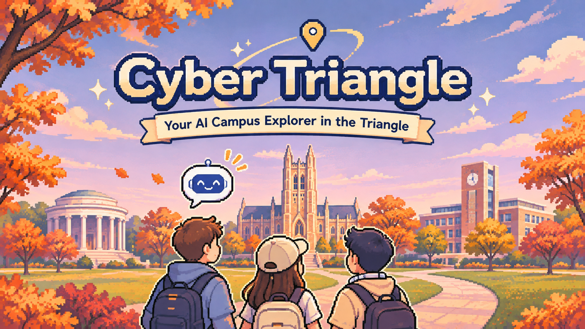
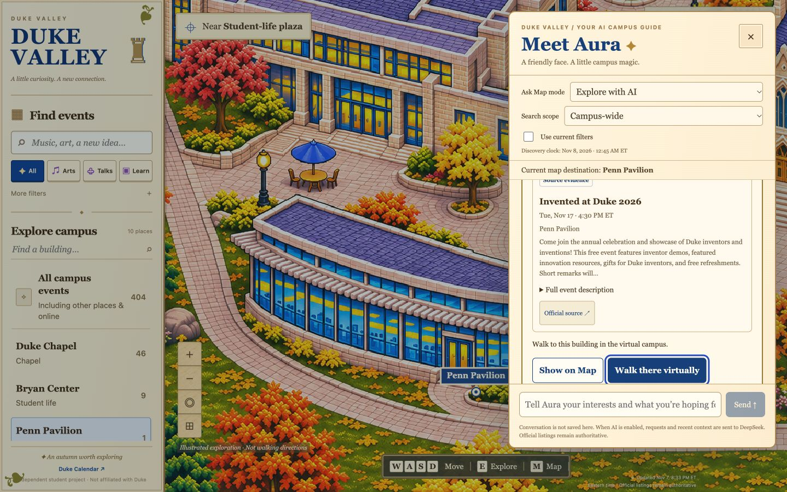

# Cyber Triangle



Welcome to Cyber Triangle, newcomer. Your first adventure awaits in **Duke Valley**.

Discover campus places, events, and new connections with an illustrated map and **Aura**, your AI campus companion. Duke Valley is our first playable experience.

[Explore Duke Valley](https://duke-valley.vercel.app/) · [Watch the demo](https://vimeo.com/1244821115)

## Alex’s first adventure

You’re Alex, a new student interested in AI and entrepreneurship, but unsure where to start.

1. Open **Ask Aura** and try **Alex’s first campus visit**, or tell Aura what interests you.
2. Discover a suggested place and the event or campus information behind it.
3. Choose **Show on Map** or **Walk there virtually** to explore.
4. Ask a follow-up or try the suggested conversation starter.



## What you can do today

- Explore an illustrated West Campus with ten places, a walking character, and a minimap.
- Find Duke events by topic, category, date, or food tag.
- Open building details and official event listings.
- Ask Aura to **Find events** or **Explore with AI** for a suggested destination.
- Continue the conversation with follow-up questions and sources attached to each answer.

## How it works

Duke Calendar supplies the event listings. A Next.js app connects a PostgreSQL event index, DeepSeek recommendations, and an interactive campus map. Aura’s suggestions link back to supporting event or campus information.

## Run locally

Use Node.js **22 or newer** and npm. From the repository root:

```sh
npm ci
cp .env.example .env
npm run dev
```

Keep your existing `.env` if you already have one. Open [localhost:3000](http://localhost:3000).

The default **fixture mode** uses a saved event snapshot: no database or API key is needed for the map, event search, or retrieval-only chat. **Explore with AI** requires model configuration. **Live mode** uses your initialized PostgreSQL database.

See [setup and release operations](docs/operations.md) for live configuration, deployment, and checks.

## Team and credits

Built by the [Cyber Triangle contributors](https://github.com/mingjie-wei/triangle-ai-hackathon/graphs/contributors), with event listings from Duke Calendar.

Independent student project.
